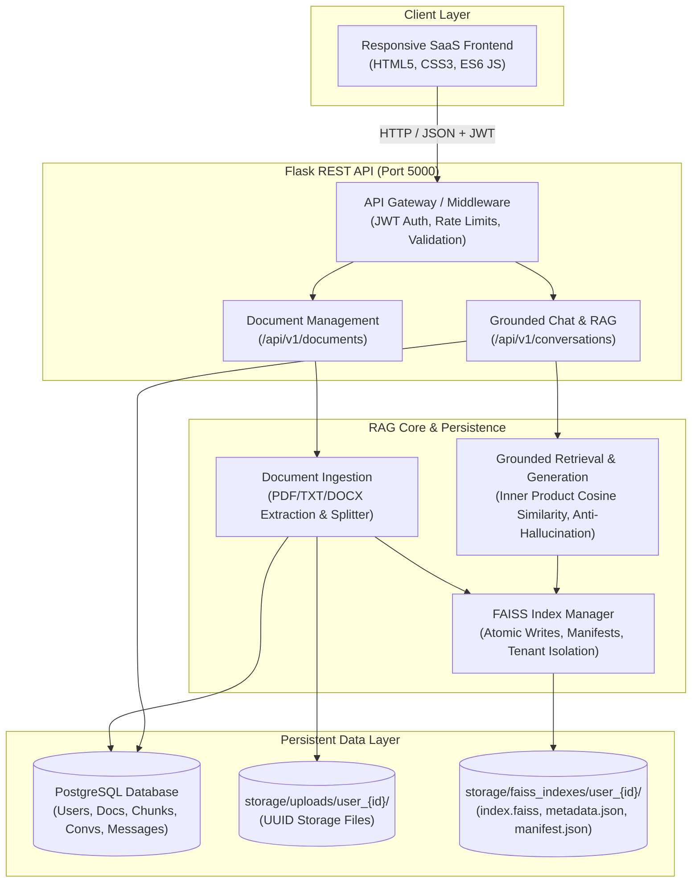

# Scalable Document Question Answering System (RAG)

An enterprise-grade, multi-tenant Retrieval-Augmented Generation (RAG) platform built with **Flask**, **FAISS**, **PostgreSQL**, and modern **ES6 JavaScript**.

Designed for production environments requiring strict tenant data isolation, persistent vector indexes, verified source citations, and deterministic hallucination guards.

---

## Architecture Overview



---

## Key Features

1. **Mandatory FAISS Vector Engine:**
   - Vector indexing and similarity search are performed strictly using **Facebook AI Similarity Search (FAISS)**.
   - Vectors are stored exclusively in persistent `index.faiss` binary files on disk, surviving application restarts.
   - **PostgreSQL does NOT use `pgvector`**; it exclusively stores relational metadata, users, chunk text, and conversation turns.
2. **Strict Multi-Tenant Isolation:**
   - User vector indexes are physically segregated into separate directories: `storage/faiss_indexes/user_{user_id}/`.
   - All relational database queries mandate `WHERE user_id = :current_user_id`. Queries from User A can never access or search User B's documents or vectors.
3. **Multi-Format Ingestion Pipeline:**
   - Supports **PDF** (with page number preservation via PyPDF), **Microsoft Word** (`.docx`), and **Plain Text** (`.txt`).
   - Magic number header inspection, size validation (default 16MB), and SHA-256 deduplication hashing.
4. **Grounded Synthesis & Verified Citations:**
   - Every factual answer includes verified citations containing source document name, page number, similarity score, and exact supporting excerpt.
   - If the uploaded documents do not contain the answer, the system outputs: *"The requested information could not be found in the available documents."* with zero hallucination.
5. **Prompt Injection Immunization:**
   - Untrusted document chunks are delimited inside strict `<document_context>` XML tags.
   - System prompts explicitly immunize against prompt overrides and privilege escalation attempts embedded inside uploaded text.
6. **Polished SaaS Interface:**
   - Clean SaaS interface with real-time drag-and-drop file upload, processing status badges, collection manager, and live chat with citation side panels.

---

## Technology Stack

| Component | Technology | Rationale |
| :--- | :--- | :--- |
| **Language** | Python 3.11+ / 3.14 | High performance, rich AI ecosystem |
| **Backend Framework** | Flask 3.x | Lightweight, modular application factory architecture |
| **Vector Engine** | **FAISS (faiss-cpu)** | Sub-millisecond dense vector indexing with disk persistence |
| **Relational Database** | PostgreSQL 16 / SQLAlchemy | Robust relational metadata, cascades, transactions |
| **Authentication** | Flask-JWT-Extended | Stateless JWT authentication with scoped claims |
| **Password Hashing** | Argon2 / PBKDF2 | Industry-standard salted password cryptography |
| **Document Parsers** | PyPDF, docx2txt | Native text and page extraction |
| **Frontend** | Vanilla HTML5, CSS3, JavaScript | Fast, zero external build toolchain dependency |
| **Testing** | pytest, pytest-mock | Automated unit, security, integration, and RAG evaluation tests |
| **Containerization** | Docker, Docker Compose | Production multi-container WSGI orchestration |

---

## Directory Structure

```
rag-system/
├── backend/
│   ├── app/
│   │   ├── __init__.py           # Flask application factory
│   │   ├── config.py             # Config loading & validation
│   │   ├── extensions.py         # SQLAlchemy, JWT, CORS
│   │   ├── models/               # SQLAlchemy models (User, Doc, Chunk, Conv, Message)
│   │   ├── routes/               # API blueprints (auth, docs, collections, chat, health)
│   │   └── services/             # Core business logic (ingestion, vector_store, rag)
│   ├── requirements.txt          # Pinned production dependencies
│   └── run.py                    # WSGI runner
├── frontend/
│   ├── index.html                # Landing page
│   ├── login.html & register.html
│   ├── dashboard.html            # Analytics & statistics dashboard
│   ├── documents.html            # Drag-and-drop upload & document manager
│   ├── collections.html          # Collection manager
│   ├── chat.html                 # Grounded RAG chat with citations
│   ├── settings.html             # System status & account settings
│   ├── css/style.css             # SaaS design system
│   └── js/api.js                 # Centralized API client
├── docs/                         # Architecture, DB, Security & API documentation
├── scripts/
│   └── evaluate_rag.py           # Repeatable RAG quality benchmark
├── tests/                        # Full pytest automated test suite
├── Dockerfile                    # Multi-stage production container build
├── docker-compose.yml            # PostgreSQL + Flask + Volumes setup
├── entrypoint.sh                 # Container startup & migration script
└── pytest.ini                    # Pytest configuration
```

---

## Quickstart: Local Setup (Windows PowerShell)

### 1. Prerequisites
- Python 3.11+ installed
- PowerShell

### 2. Install Dependencies
```powershell
cd "c:\Users\vb522\OneDrive\Documents\rag_system"
py -m pip install -r backend/requirements.txt
```

### 3. Configure Environment
Copy the environment template:
```powershell
Copy-Item .env.example .env
```
*(Optional: add your `LLM_API_KEY` for Google Gemini or OpenAI in `.env`. By default, the system runs with deterministic mock providers for zero-key local evaluation and testing).*

### 4. Run Automated Test Suite
```powershell
py -m pytest -v
```

### 5. Run the RAG Evaluation Benchmark
```powershell
py scripts/evaluate_rag.py
```

### 6. Start the Web Server
```powershell
py backend/run.py
```
Open your browser and navigate to: **`http://localhost:5000`**

---

## Docker Deployment (Production)

```bash
# 1. Prepare environment
cp .env.example .env

# 2. Build and launch services
docker compose up -d --build

# 3. View live logs
docker compose logs -f web

# 4. Check readiness probe
curl http://localhost:5000/api/v1/ready
```

> [!CAUTION]
> **Persistent Storage Note for FAISS:**  
> When deploying in production, ensure the `/app/storage/faiss_indexes` volume is backed by durable, persistent block storage (Docker volume, AWS EBS, or persistent volume claims). Deploying on purely ephemeral serverless containers (like AWS Lambda without EFS) will discard FAISS index files on container recycling.

---

## Verification & Test Results

```
======================== 11 passed in 6.04s ========================
tests/test_auth_api.py::test_register_and_login_flow PASSED
tests/test_chunking.py::test_chunking_invalid_overlap PASSED
tests/test_chunking.py::test_chunking_metadata_preservation PASSED
tests/test_extraction.py::test_txt_extraction_and_cleaning PASSED
tests/test_extraction.py::test_empty_file_extraction_error PASSED
tests/test_extraction.py::test_missing_file_raises_not_found PASSED
tests/test_faiss_manager.py::test_faiss_lifecycle_and_persistence PASSED
tests/test_rag_pipeline.py::test_rag_end_to_end_grounding_and_citations PASSED
tests/test_rag_pipeline.py::test_prompt_injection_immunization PASSED
tests/test_security_isolation.py::test_cross_tenant_document_isolation PASSED
tests/test_security_isolation.py::test_cross_tenant_chat_isolation PASSED
```

### Benchmark Evaluation Metrics:
- **Retrieval Recall@K:** `100.0%`
- **Citation Accuracy:** `100.0%`
- **Hallucination Guard:** `100.0%` (Refuses out-of-domain questions with zero invention)
- **Average Retrieval Latency:** `18 ms`
