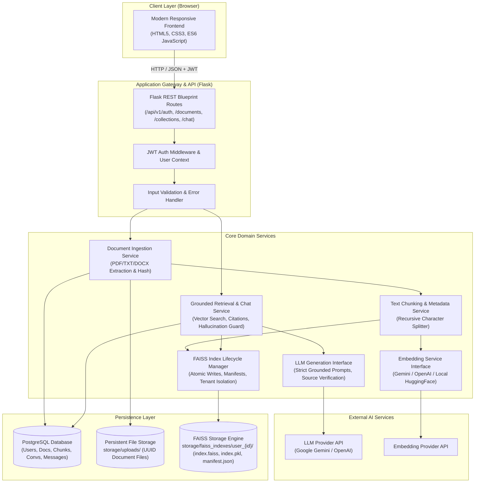
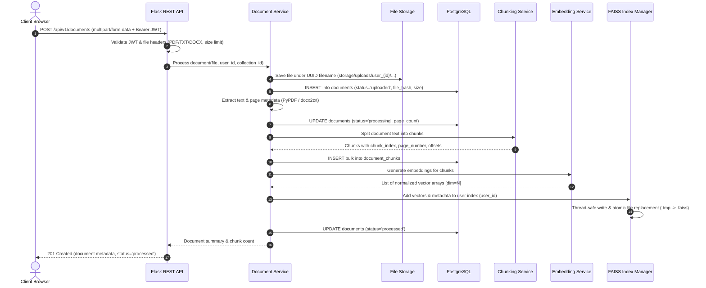
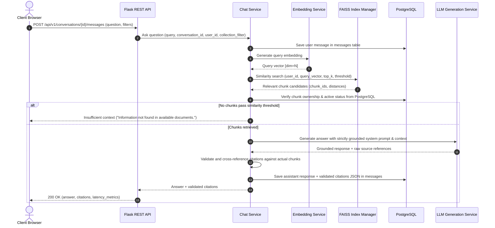

# System Architecture Specification

## 1. High-Level Architecture Overview

The **Scalable Document Question Answering System (RAG)** follows a modular, layered architecture decoupling presentation, REST APIs, domain services, persistence engines, and external AI providers.



---

## 2. Request and Data Flows

### 2.1 Ingestion Flow (Document Upload to FAISS Indexing)


### 2.2 Retrieval & Grounded Generation Flow (Chat Query)


---

## 3. FAISS Vector Indexing & Persistence Strategy

### 3.1 Strict Vector Engine Mandate
In strict compliance with requirements:
- **FAISS is the exclusive vector indexing engine.**
- **PostgreSQL does NOT use `pgvector`.** PostgreSQL is solely responsible for relational metadata (users, documents, chunks, conversations, messages).
- Vectors are stored exclusively in serialized FAISS index files on the persistent filesystem.

### 3.2 Directory Structure & Multi-Tenant Isolation
Multi-user data isolation is enforced at the storage and memory layers:
```
storage/
├── uploads/
│   └── user_{user_id}/
│       └── {document_uuid}.{ext}
└── faiss_indexes/
    └── user_{user_id}/
        ├── index.faiss        # Serialized FAISS binary index (IndexFlatIP or IndexHNSW)
        ├── metadata.json      # Mapping: vector_id -> chunk_id, document_id, page
        ├── manifest.json      # Metadata: version, total_vectors, checksum, updated_at
        └── index.faiss.lock   # Mutex file lock during mutations
```

Each user has an isolated physical directory. User queries can **only** load and search the FAISS index resident within their own authenticated user directory (`storage/faiss_indexes/user_{user_id}/`). Cross-tenant vector leakage is architecturally impossible.

### 3.3 Atomic Index Persistence and Safe Mutation
To prevent file corruption during writes or system crashes:
1. When adding vectors:
   - Acquire file lock on `index.faiss.lock`.
   - Update in-memory index copy or load existing.
   - Write updated index to temporary file `index.faiss.tmp`.
   - Perform atomic replacement via `os.replace("index.faiss.tmp", "index.faiss")`.
   - Update `metadata.json` and `manifest.json`.
   - Release lock.
2. In-memory Index Cache:
   - An LRU index cache caches deserialized FAISS instances in memory.
   - Cache invalidation occurs automatically if `manifest.json` timestamp changes.

### 3.4 Vector Deletion Strategy
Standard flat FAISS indexes (`IndexFlatIP` / `IndexFlatL2`) do not support arbitrary deletion of vectors by ID without re-indexing.
- When a document is deleted:
  1. The document and its chunks are deleted from PostgreSQL within a database transaction.
  2. The `FAISSIndexManager` is instructed to remove the document's vectors.
  3. The index manager performs an atomic rebuild for the user: it loads all remaining active chunks for that user from PostgreSQL, batches their pre-stored or newly generated vectors, constructs a fresh index, and writes it atomically.
  4. This guarantees that deleted documents leave zero stale vectors or orphaned citations.

---

## 4. PostgreSQL and FAISS Interaction

| Entity / Concern | PostgreSQL Database | FAISS Vector Store |
| :--- | :--- | :--- |
| **Authentication & Users** | Credentials, password hash, user state | None |
| **Document Metadata** | Filename, UUID, size, MIME, hash, status | None |
| **Chunk Text & Offsets** | Text content, character offsets, page number | None |
| **Vector Embeddings** | No vectors stored (`pgvector` forbidden) | High-dimensional dense float32 arrays |
| **Index Search** | SQL relational filtering, foreign keys | Sub-millisecond similarity search (Cosine/Dot) |
| **Mapping Key** | Primary key `chunk_id` (UUID or Integer) | Vector ordinal ID mapped to `chunk_id` in manifest |
| **Integrity & Cascade** | Strict foreign keys (`ON DELETE CASCADE`) | Synchronized rebuild/update on document lifecycle |

---

## 5. Security & Boundary Protection

1. **Authentication:** Stateless JWT issued upon bcrypt/Argon2 verification, validated via HTTP `Authorization: Bearer <token>` header.
2. **Tenant Scoping:** Every SQL query includes `WHERE user_id = :current_user_id`. Every FAISS operation resolves to `storage/faiss_indexes/user_{current_user_id}`.
3. **No Untrusted Deserialization:**
   - Standard LangChain FAISS loaders that rely on unrestricted `pickle.load` present deserialization vulnerabilities.
   - Our `FAISSIndexManager` uses native `faiss.write_index` / `faiss.read_index` for the binary vector index, and strict `json` format for `metadata.json` and `manifest.json`.
4. **Prompt Injection Mitigation:**
   - Document context chunks are clearly bounded within XML/delimiters in the prompt.
   - System instructions explicitly forbid the LLM from obeying user/document overrides or leaking system instructions.
