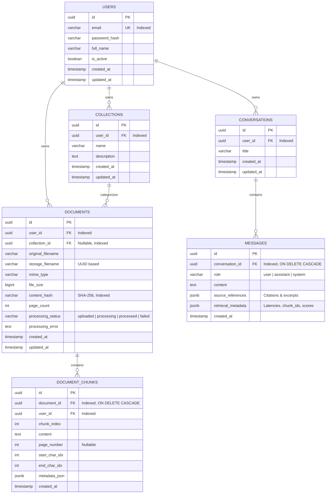

# Database Design Specification

## 1. Relational Database Overview

The relational persistence tier uses **PostgreSQL** managed through **SQLAlchemy ORM** and version-controlled via **Flask-Migrate (Alembic)**.

> [!IMPORTANT]
> **No vector column or pgvector extension is used.** In strict compliance with the architecture specification, vector embeddings are stored exclusively in persistent FAISS binary indexes on disk. PostgreSQL manages application state, user accounts, document metadata, chunk text, and conversation histories.

---

## 2. Entity-Relationship Diagram (ERD)

---

## 3. Detailed Table Definitions

### 3.1 `users` Table
Stores registered accounts and authentication credentials.

| Column | Type | Constraints | Description |
| :--- | :--- | :--- | :--- |
| `id` | UUID | PRIMARY KEY, default `gen_random_uuid()` | Unique user identifier |
| `email` | VARCHAR(255) | NOT NULL, UNIQUE, INDEXED | User email address (lowercased) |
| `password_hash` | VARCHAR(255) | NOT NULL | Argon2 / Werkzeug salted hash |
| `full_name` | VARCHAR(120) | NULL | Optional user display name |
| `is_active` | BOOLEAN | NOT NULL, default TRUE | Account status flag |
| `created_at` | TIMESTAMP WITH TIME ZONE | NOT NULL, default NOW() | Account creation time |
| `updated_at` | TIMESTAMP WITH TIME ZONE | NOT NULL, default NOW() | Last update timestamp |

### 3.2 `collections` Table
Allows users to partition their documents into topical or project collections.

| Column | Type | Constraints | Description |
| :--- | :--- | :--- | :--- |
| `id` | UUID | PRIMARY KEY, default `gen_random_uuid()` | Unique collection identifier |
| `user_id` | UUID | NOT NULL, FOREIGN KEY (`users.id`) ON DELETE CASCADE | Owner user |
| `name` | VARCHAR(120) | NOT NULL | Collection name |
| `description` | TEXT | NULL | Optional description |
| `created_at` | TIMESTAMP WITH TIME ZONE | NOT NULL, default NOW() | Creation timestamp |
| `updated_at` | TIMESTAMP WITH TIME ZONE | NOT NULL, default NOW() | Last update timestamp |

*Constraints:* `UNIQUE(user_id, name)` ensures users cannot create duplicate collection names.

### 3.3 `documents` Table
Tracks uploaded files, storage paths, processing state, and deduplication hashes.

| Column | Type | Constraints | Description |
| :--- | :--- | :--- | :--- |
| `id` | UUID | PRIMARY KEY, default `gen_random_uuid()` | Document ID |
| `user_id` | UUID | NOT NULL, FOREIGN KEY (`users.id`) ON DELETE CASCADE | Document owner |
| `collection_id` | UUID | NULL, FOREIGN KEY (`collections.id`) ON DELETE SET NULL | Optional collection |
| `original_filename`| VARCHAR(255) | NOT NULL | Original uploaded filename |
| `storage_filename` | VARCHAR(255) | NOT NULL, UNIQUE | Secure UUID filename on disk |
| `mime_type` | VARCHAR(100) | NOT NULL | Verified MIME type |
| `file_size` | BIGINT | NOT NULL | File size in bytes |
| `content_hash` | VARCHAR(64) | NOT NULL | SHA-256 hash for deduplication |
| `page_count` | INTEGER | NULL | Total pages extracted (for PDFs) |
| `processing_status`| VARCHAR(20) | NOT NULL, default `'uploaded'` | Status: `uploaded`, `processing`, `processed`, `failed` |
| `processing_error` | TEXT | NULL | Error traceback if status = failed |
| `created_at` | TIMESTAMP WITH TIME ZONE | NOT NULL, default NOW() | Upload timestamp |
| `updated_at` | TIMESTAMP WITH TIME ZONE | NOT NULL, default NOW() | Last updated timestamp |

*Indexes:*
- `idx_documents_user_id` on `user_id`
- `idx_documents_collection_id` on `collection_id`
- `idx_documents_content_hash` on `(user_id, content_hash)`

### 3.4 `document_chunks` Table
Holds the parsed and split text chunks corresponding to vector entries in FAISS.

| Column | Type | Constraints | Description |
| :--- | :--- | :--- | :--- |
| `id` | UUID | PRIMARY KEY, default `gen_random_uuid()` | Chunk primary key |
| `document_id` | UUID | NOT NULL, FOREIGN KEY (`documents.id`) ON DELETE CASCADE | Associated document |
| `user_id` | UUID | NOT NULL, FOREIGN KEY (`users.id`) ON DELETE CASCADE | Owner user (for isolation) |
| `chunk_index` | INTEGER | NOT NULL | Sequential index within document |
| `content` | TEXT | NOT NULL | Text payload for context building |
| `page_number` | INTEGER | NULL | Source page number (1-indexed) |
| `start_char_idx` | INTEGER | NULL | Character start offset in document |
| `end_char_idx` | INTEGER | NULL | Character end offset in document |
| `metadata_json` | JSONB | NULL | Dynamic metadata (headers, section) |
| `created_at` | TIMESTAMP WITH TIME ZONE | NOT NULL, default NOW() | Ingestion timestamp |

*Indexes:*
- `idx_chunks_doc_idx` on `(document_id, chunk_index)`
- `idx_chunks_user_id` on `user_id`

### 3.5 `conversations` Table
Tracks chat sessions for each user.

| Column | Type | Constraints | Description |
| :--- | :--- | :--- | :--- |
| `id` | UUID | PRIMARY KEY, default `gen_random_uuid()` | Conversation ID |
| `user_id` | UUID | NOT NULL, FOREIGN KEY (`users.id`) ON DELETE CASCADE | Owner user |
| `title` | VARCHAR(255) | NOT NULL, default `'New Conversation'` | Conversation title |
| `created_at` | TIMESTAMP WITH TIME ZONE | NOT NULL, default NOW() | Session start timestamp |
| `updated_at` | TIMESTAMP WITH TIME ZONE | NOT NULL, default NOW() | Last message timestamp |

### 3.6 `messages` Table
Tracks individual turns in a conversation, including query, response, and grounded citations.

| Column | Type | Constraints | Description |
| :--- | :--- | :--- | :--- |
| `id` | UUID | PRIMARY KEY, default `gen_random_uuid()` | Message ID |
| `conversation_id` | UUID | NOT NULL, FOREIGN KEY (`conversations.id`) ON DELETE CASCADE | Associated conversation |
| `role` | VARCHAR(20) | NOT NULL | `'user'`, `'assistant'`, or `'system'` |
| `content` | TEXT | NOT NULL | Text content of the turn |
| `source_references`| JSONB | NULL | Array of citation objects |
| `retrieval_metadata`| JSONB | NULL | Retrieval latency, similarity scores |
| `created_at` | TIMESTAMP WITH TIME ZONE | NOT NULL, default NOW() | Message timestamp |

---

## 4. Deletion and Cascading Behavior

1. **User Deletion:** Deleting a user cascades to all their collections, documents, chunks, conversations, and messages (`ON DELETE CASCADE`). The application hook also cleans up the user's upload directory and FAISS index directory on disk.
2. **Collection Deletion:** Deleting a collection sets `collection_id = NULL` on associated documents (`ON DELETE SET NULL`) so documents are not unintentionally lost, or can be explicitly cascade-deleted if specified by the user.
3. **Document Deletion:** Deleting a document automatically cascades to delete all its `document_chunks` in PostgreSQL. In addition, the `FAISSIndexManager` is triggered to rebuild the user's FAISS index excluding the deleted document's chunks.
4. **Conversation Deletion:** Deleting a conversation cascades to delete all associated messages.
