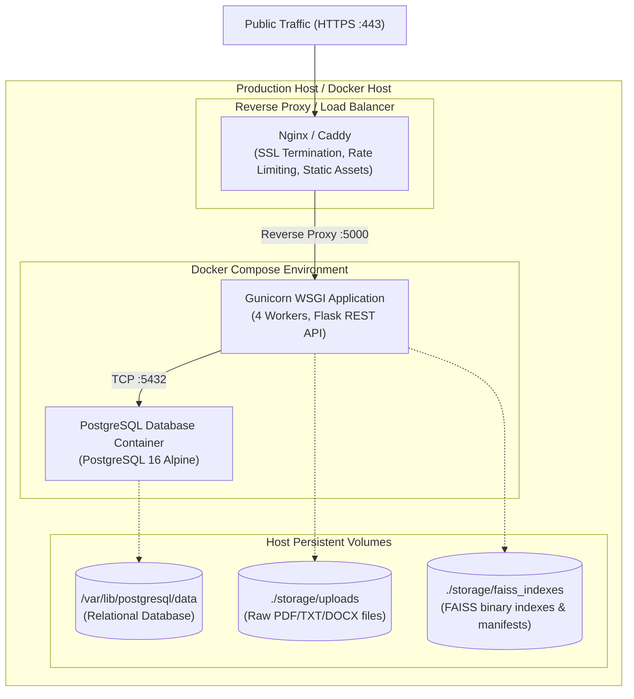

# Deployment and Operational Plan

## 1. Deployment Topology

The application is architected for containerized and non-containerized deployments with explicit persistence guarantees for PostgreSQL data, uploaded files, and FAISS vector indexes.



---

## 2. Docker & Compose Configuration

### 2.1 Services Defined
1. **`db` (PostgreSQL):**
   - Image: `postgres:16-alpine`
   - Healthcheck: `pg_isready -U ${POSTGRES_USER} -d ${POSTGRES_DB}`
   - Volume: `postgres_data:/var/lib/postgresql/data`
2. **`web` (Flask + Gunicorn):**
   - Image: Built from project `Dockerfile`
   - Entrypoint: Runs database migrations (`flask db upgrade`) before spawning Gunicorn.
   - Command: `gunicorn -w 4 -b 0.0.0.0:5000 "backend.app:create_app()"`
   - Healthcheck: HTTP probe on `GET /api/v1/health`
   - Volumes:
     - `app_uploads:/app/storage/uploads`
     - `app_faiss:/app/storage/faiss_indexes`

---

## 3. Storage Architecture: Ephemeral Filesystem Limitation & FAISS

> [!CAUTION]
> **Critical Architectural Warning: Ephemeral Cloud Storage**  
> Serverless platforms (e.g., AWS Lambda, Google Cloud Run without mounted Cloud Storage) and ephemeral PaaS dynos (e.g., legacy Heroku) discard local disk storage on redeployment or container restart.
> Because **FAISS operates directly on persistent binary files**, deploying this application on purely ephemeral filesystems will cause catastrophic loss of all vector indexes upon restart.

### Persistence Solutions:
1. **Docker Host / VPS (DigitalOcean, Linode, AWS EC2, Azure VM):**
   - Docker volumes mounted to durable host block storage (ext4/EBS) ensure FAISS indexes and uploads survive container stops, restarts, and image updates.
2. **Kubernetes / Container Orchestration:**
   - Mount a `PersistentVolumeClaim` (PVC) with `ReadWriteOnce` (or `ReadWriteMany`) backing the `/app/storage` directory.
3. **Index Reconstruction Recovery Hook:**
   - If a disaster occurs and index files are missing, the system includes an automatic recovery mechanism: the `FAISSIndexManager` can rebuild the user's index on demand from the `document_chunks` table stored in PostgreSQL.

---

## 4. Multi-Worker & Horizontal Scaling Strategy

### 4.1 Single-Writer Local File Locking
- On a single server running multiple Gunicorn worker processes (e.g., 4 workers):
  - Workers share the local filesystem `/app/storage/faiss_indexes`.
  - Concurrent writes to a user's FAISS index are protected using inter-process file locks (`portalocker` / `fcntl` / `msvcrt` locks on `index.faiss.lock`).
  - Read queries acquire shared locks or load the latest committed `.faiss` file, avoiding read-write torn states.

### 4.2 Horizontal Scaling Evolution (Multi-Node Clusters)
- For multi-node distributed scaling in the future:
  - Relational tier scales via AWS Aurora / Cloud SQL.
  - Ingestion tasks are queued via Redis + Celery / RQ.
  - Vector search moves to a centralized dedicated FAISS microservice, or persistent network-attached storage (NFS / EFS) with distributed index coordination.

---

## 5. Step-by-Step Local Execution Instructions

### 5.1 Local Execution via Windows PowerShell (Without Docker)

```powershell
# 1. Clone repository & navigate to workspace
cd "c:\Users\vb522\OneDrive\Documents\rag_system"

# 2. Create Python virtual environment
py -m venv .venv

# 3. Activate virtual environment
.\.venv\Scripts\Activate.ps1

# 4. Install tested dependencies
pip install --upgrade pip
pip install -r backend/requirements.txt

# 5. Configure environment variables
Copy-Item .env.example .env
# Open .env and set your DATABASE_URL and LLM_API_KEY

# 6. Apply database migrations
flask --app backend/run.py db upgrade

# 7. Start the development server
python backend/run.py
```
*Access UI at:* `http://localhost:5000`

### 5.2 Execution via Docker Compose

```bash
# 1. Copy environment template
cp .env.example .env

# 2. Build and start containers
docker compose up -d --build

# 3. Inspect container logs
docker compose logs -f web

# 4. Check system health
curl http://localhost:5000/api/v1/health
```

---

## 6. Backup, Recovery & Maintenance

1. **PostgreSQL Backup:**
   ```bash
   docker compose exec db pg_dump -U postgres rag_db > backups/db_$(date +%Y%m%d).sql
   ```
2. **FAISS Index Backup:**
   ```bash
   tar -czvf backups/faiss_$(date +%Y%m%d).tar.gz storage/faiss_indexes/
   ```
3. **Disaster Recovery Re-indexing:**
   - If FAISS storage is corrupted, execute:
   ```bash
   flask --app backend/run.py reindex-all-users
   ```
   This iterates over all active `document_chunks` in PostgreSQL, re-embeds, and regenerates intact `.faiss` and `metadata.json` manifests atomically.
